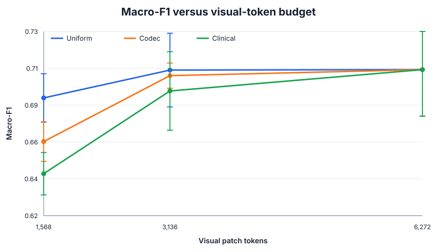

# Codec-native sparse tokens for cataract phase recognition

This repository is an applied extension of [Mage-VL: An Efficient Codec-Native
Streaming Multimodal Foundation Model](https://arxiv.org/abs/2607.24904). It
isolates Mage-VL's anchor/predicted-frame token-selection idea and tests it on
[Cataract-101](https://ftp.itec.aau.at/datasets/ovid/cat-101/) surgical phase
recognition.

The v0.2 result is negative but useful: with a frozen ViT that encodes each
frame fragment independently, uniform temporal sampling was stronger than both
the codec-guided and learned clinical selectors. The learned clinical signal
did not beat the codec signal. This is an implementation-specific result, not a
general verdict on codec-native tokenization; see the
[method audit](docs/METHOD_AUDIT.md).



## Result

Mean ± sample SD over seeds 17, 29, and 43:

| Selector | Tokens | Accuracy | Macro-F1 | Transition accuracy | Forward ms/sample |
|---|---:|---:|---:|---:|---:|
| Uniform | 1,568 | **0.7501 ± 0.0081** | **0.6903 ± 0.0144** | **0.5997 ± 0.0231** | **34.43 ± 0.48** |
| Codec | 1,568 | 0.7228 ± 0.0142 | 0.6643 ± 0.0118 | 0.5591 ± 0.0094 | 133.67 ± 1.80 |
| Clinical | 1,568 | 0.7108 ± 0.0108 | 0.6451 ± 0.0127 | 0.5476 ± 0.0183 | 134.81 ± 1.55 |
| Uniform | 3,136 | 0.7610 ± 0.0167 | **0.7070 ± 0.0220** | **0.6385 ± 0.0127** | **68.29 ± 1.12** |
| Codec | 3,136 | **0.7612 ± 0.0075** | 0.7036 ± 0.0075 | 0.6063 ± 0.0158 | 135.54 ± 1.27 |
| Clinical | 3,136 | 0.7551 ± 0.0159 | 0.6945 ± 0.0234 | 0.5740 ± 0.0165 | 134.30 ± 1.16 |
| Uniform | 6,272 | 0.7621 ± 0.0232 | 0.7072 ± 0.0278 | 0.6294 ± 0.0451 | 138.26 ± 1.28 |
| Codec | 6,272 | 0.7621 ± 0.0232 | 0.7072 ± 0.0278 | 0.6294 ± 0.0451 | 136.94 ± 2.27 |
| Clinical | 6,272 | 0.7621 ± 0.0232 | 0.7072 ± 0.0278 | 0.6294 ± 0.0451 | 136.36 ± 1.90 |

At 1,568 tokens, codec and clinical selection reduced macro-F1 by 0.0261 and
0.0453 respectively relative to uniform sampling. At 3,136 tokens, codec
matched uniform accuracy but not macro-F1 or transition accuracy. At 6,272
tokens every method selects the full input, and their predictions match exactly
within each seed—an implementation sanity check.

The reported v0.2 latency is synchronized **model-forward time per sample**, but
is dominated by one encoder call per represented frame. Uniform uses 8/16/32
calls while sparse arms spread tokens across nearly every frame. It excludes
data loading, decode, cache construction, and score generation, and must not be
treated as an architecture-independent speed comparison. The current code
batches equal-length frame fragments to permit a corrected remeasurement.

See [the full report](reports/FINAL_REPORT.md) for paired comparisons,
per-phase errors, qualitative selector maps, and limitations.

## Methods

- **Uniform:** complete 14×14 patch grids from uniformly spaced frames.
- **Codec:** dense native H.264 anchors plus predicted-frame patches ranked by
  motion-vector magnitude and decoded motion-compensated L1 residual.
- **Clinical:** the same anchor and token-allocation rules, but predicted-frame
  patches are ranked by a lightweight phase/transition-supervised scorer.
- **Budgets:** 1,568 / 3,136 / 6,272 patches, equivalent to 8 / 16 / 32 dense
  224×224 frames with 16×16 patches.
- **Protocol:** deterministic 71/15/15 procedure split, validation-selected
  checkpoints, held-out test evaluation, and three seeds.

This is a mechanism study, not a reproduction of Mage-VL. It uses original
H.264/AVC streams rather than HEVC, an off-the-shelf frozen image encoder and a
lightweight temporal classifier rather than Mage-ViT/VLM pretraining, and a
decoded residual proxy rather than bit-exact transform coefficients.
The frozen ViT also does not attend jointly over sparse tokens from different
frames; only mean-pooled frame vectors enter the temporal transformer.

## Repository map

```text
configs/                     selector and training configurations
src/surgical_tokens/         codec extraction, budgeting, datasets, models
scripts/train.py             matched-budget training and evaluation
scripts/analyze_results.py   27-run validation, statistics, CSVs, SVG figures
scripts/qualitative_selectors.py
                              selector-disagreement triptychs
scripts/export_predictions.py per-clip prediction and timing export
scripts/bootstrap_procedures.py
                              paired held-out-procedure bootstrap
cataract101_runs/            canonical result JSON and checkpoints
reports/                     final report, tables, figures, qualitative cases
tests/                       budget, codec, dataset, and selector tests
*.pbs                        NSCC PBS workflows
```

## Reproduce the reporting layer

The analysis scripts need Python 3.10+, NumPy, and Pillow; they do not require a
GPU:

```bash
python scripts/analyze_results.py
python scripts/qualitative_selectors.py
```

`analyze_results.py` accepts only the 27 canonical directories matching
`{selector}_budget{budget}_seed{seed}`. The two historical nested copies are
therefore excluded automatically.

For environment setup, data conversion, score-cache construction, and PBS
training commands, see [the reproduction guide](docs/REPRODUCING.md) and
[experimental protocol](docs/PROTOCOL.md).

## Citation and licensing

The dataset is subject to the Cataract-101 terms; raw videos and extracted
frames should not be committed to a public repository. Cite the Cataract-101
MMSys 2018 paper and the Mage-VL technical report when using this work. Code
licensing does not override dataset or pretrained-weight licenses.
