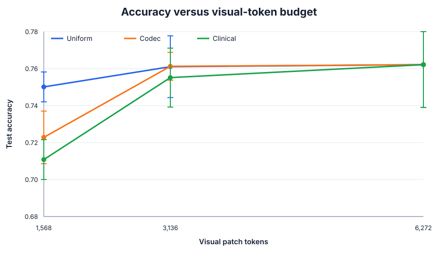
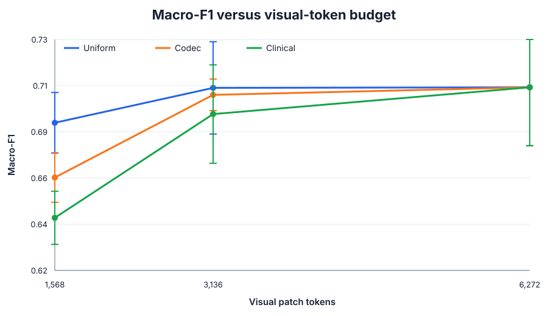
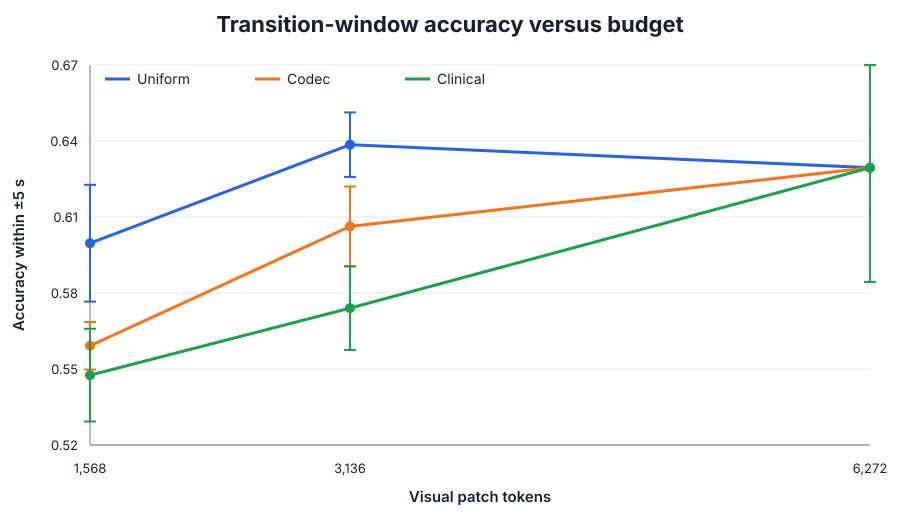
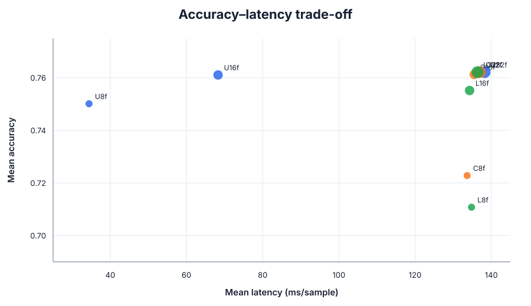

# A scoped evaluation of codec-native token selection for cataract surgery

## Executive summary

This study asks whether the codec-native token-selection mechanism introduced
by [Mage-VL](https://arxiv.org/abs/2607.24904) transfers to surgical phase
recognition, and whether a learned domain-supervised importance signal improves
on codec saliency. Three selectors were trained and evaluated on
[Cataract-101](https://ftp.itec.aau.at/datasets/ovid/cat-101/) under identical
patch-token budgets and procedure splits.

The directional hypotheses were not supported. Uniform temporal sampling was
best at the most constrained budget, remained preferable at the middle budget
when macro-F1, transition accuracy, and forward cost were considered together,
and the learned clinical signal did not beat codec saliency. All arms converged
exactly at the dense endpoint, confirming that the selection implementations
produce the same input when no sparsification is applied.

## Research question and hypotheses

At a fixed visual patch-token budget:

1. Does codec-guided sparse selection outperform uniform frame sampling?
2. Does learned phase/transition-supervised selection outperform uniform sampling?
3. Does learned clinical selection outperform codec selection?

The expected ordering was clinical > codec > uniform at sparse budgets. The
observed ordering was generally uniform > codec > clinical.

## Experimental design

Cataract-101 contains 101 cataract surgery videos with ten phase annotations.
The converter froze a procedure-level 71/15/15 train/validation/test split. All
clips from one procedure remain in one partition. Checkpoints were selected by
validation macro-F1 and the held-out test split was evaluated once per run.

Each 224×224 frame yields a 14×14 grid of 16×16 patches. Budgets of 1,568,
3,136, and 6,272 therefore equal 8, 16, and 32 dense frames. The experiment is
a 3-selector × 3-budget × 3-seed factorial design (27 runs; seeds 17, 29, 43).

The codec selector uses native H.264 motion vectors plus a decoded
motion-compensated L1 residual proxy. The clinical selector uses identical
anchor and allocation rules but replaces predicted-frame saliency with a
lightweight scorer trained using phase and ±5-second transition supervision.

## Aggregate results

Mean ± sample SD across three seeds:

| Selector | Tokens | Accuracy | Macro-F1 | ±5 s transition accuracy | Forward ms/sample |
|---|---:|---:|---:|---:|---:|
| Uniform | 1,568 | **0.7501 ± 0.0081** | **0.6903 ± 0.0144** | **0.5997 ± 0.0231** | **34.43 ± 0.48** |
| Codec | 1,568 | 0.7228 ± 0.0142 | 0.6643 ± 0.0118 | 0.5591 ± 0.0094 | 133.67 ± 1.80 |
| Clinical | 1,568 | 0.7108 ± 0.0108 | 0.6451 ± 0.0127 | 0.5476 ± 0.0183 | 134.81 ± 1.55 |
| Uniform | 3,136 | 0.7610 ± 0.0167 | **0.7070 ± 0.0220** | **0.6385 ± 0.0127** | **68.29 ± 1.12** |
| Codec | 3,136 | **0.7612 ± 0.0075** | 0.7036 ± 0.0075 | 0.6063 ± 0.0158 | 135.54 ± 1.27 |
| Clinical | 3,136 | 0.7551 ± 0.0159 | 0.6945 ± 0.0234 | 0.5740 ± 0.0165 | 134.30 ± 1.16 |
| Uniform | 6,272 | 0.7621 ± 0.0232 | 0.7072 ± 0.0278 | 0.6294 ± 0.0451 | 138.26 ± 1.28 |
| Codec | 6,272 | 0.7621 ± 0.0232 | 0.7072 ± 0.0278 | 0.6294 ± 0.0451 | 136.94 ± 2.27 |
| Clinical | 6,272 | 0.7621 ± 0.0232 | 0.7072 ± 0.0278 | 0.6294 ± 0.0451 | 136.36 ± 1.90 |

## Paired seed-wise comparisons

The paired analysis uses only three seeds, so confidence intervals and t-test
p-values are exploratory and are not corrected for multiple comparisons.

At 1,568 tokens:

- Codec minus uniform macro-F1 was **−0.0261** (95% paired t interval
  [−0.0351, −0.0171], exploratory p=0.0064).
- Clinical minus uniform macro-F1 was **−0.0453** ([−0.0704, −0.0201], p=0.0162).
- Clinical minus codec macro-F1 was **−0.0192**, but its small-sample interval
  crossed zero ([−0.0470, 0.0086], p=0.0969).

At 3,136 tokens, codec and uniform accuracy differed by only +0.0002. Codec
macro-F1 was 0.0033 lower, with substantial seed uncertainty. Clinical was
0.0125 macro-F1 below uniform. Transition accuracy showed the clearest middle-
budget separation: clinical trailed uniform by 0.0645 and codec by 0.0323.

At 6,272 tokens, all three selectors produced identical accuracy, macro-F1,
transition accuracy, and per-class metrics within each seed. This is expected:
the budget retains the full 32-frame patch grid, leaving no selector decision.

## Efficiency result and implementation artifact

At 1,568 tokens, uniform sampling used 34.43 ms/sample of synchronized model
forward time, versus 133.67 ms for codec and 134.81 ms for clinical selection.
At 3,136 tokens, uniform required 68.29 ms versus roughly 135 ms for the sparse
arms. This gap is primarily an implementation artifact. The evaluated
`SparseTemporalClassifier` called the frozen ViT separately for every
represented frame. Uniform therefore made approximately 8, 16, and 32 encoder
calls at the three budgets, while sparse selection distributed patches across
nearly all 32 frames at both sparse budgets. The near-linear uniform timing
(about 4.3 ms per frame) supports this explanation.

The repository now groups equal-length frame fragments into batched encoder
calls without changing v0.2 attention semantics. Existing timing values have
not been relabeled: corrected latency requires re-evaluating the checkpoints.
A truly joint sparse encoder is a separate architectural correction.

This timing excludes dataloader work, video decode, cache construction, and
importance-score generation. It must not be described as end-to-end codec
streaming latency, median latency, or p95 latency.

## Phase-level error pattern

At 1,568 tokens, uniform sampling was notably stronger for Incision (mean F1
0.743 versus 0.685 codec and 0.626 clinical), Viscous Agent Injection (0.486
versus 0.422 and 0.399), Rhexis (0.786 versus 0.740 and 0.682), and Capsule
Polishing (0.615 versus approximately 0.540 for both sparse selectors).

Codec selection did show localized advantages: Lens Implant Setting-Up improved
from 0.680 uniform F1 to 0.704, and Tonifying/Antibiotics improved from 0.560 to
0.627. Those gains were too narrow to offset losses in the remaining phases.
The complete class table is in [`per_class_f1.csv`](per_class_f1.csv).

## Qualitative selector behaviour

The three cases below were selected automatically from the locally available
frame subset by minimizing Jaccard overlap between each selector's top 20% of
patches, while requiring distinct procedures. They illustrate selector
disagreement, not classification errors; clip-level predictions were not saved
during the original evaluation.

Across these examples, the codec proxy responds sharply to moving instrument
edges, specular changes, and local high-frequency residuals. The learned scorer
is smoother and often emphasizes broad central or peripheral anatomical
regions. Zero overlap between the displayed top-20% masks confirms that the
signals can prioritize entirely different evidence. The aggregate result shows
that this learned spatial prior was not sufficiently phase-discriminative under
the present supervision.

## Interpretation and architecture mismatch

Mage-VL's result depends on a jointly designed and pretrained visual encoder,
codec tokenization strategy, and large-scale video training. In v0.2, selected
patches from each frame pass independently through a frozen densely pretrained
ViT and are mean-pooled to one frame vector. Only those frame vectors enter a
two-layer temporal transformer. The spatial encoder never attends across
frames; spatial positions come from pretrained 2D absolute embeddings, and a
learned frame embedding is added only after spatial encoding. Sparse fragments
were therefore presented to an encoder that was neither structured nor trained
for joint sparse spatio-temporal tokens. This is the strongest confound and
means the negative result cannot be generalized to Mage-ViT.

The codec cache introduces a second mismatch. Native importance is computed
against the immediately preceding decoded frame at roughly 25 fps, while model
inputs are sampled at 2 fps. The selected saliency therefore describes about
40 ms of change rather than redundancy over the roughly 0.5-second model
interval. A new cache option aggregates codec evidence over each sampled
interval, but it requires new codec-arm runs.

The learned scorer's supervision is weakly aligned with the target. Its
phase-attention softmax is invariant to a constant offset within each frame,
yet downstream selection ranks raw logits across all frames. Weak sparsity
regularization may not calibrate those offsets. Codec scores are normalized
per frame, so the arms are also asymmetric. The code now exposes symmetric
per-frame rank normalization as an ablation; a stronger fix is clip-level
training that explicitly calibrates patch utility across time. Phase and
transition labels alone tell the model *when* workflow changes, not which
patches causally identify the phase.

## Claim boundary and limitations

- This is a scoped extension, not a reproduction of Mage-VL.
- Cataract-101 supplies H.264/AVC, not HEVC. Motion vectors are codec-native;
  residual importance is a decoded motion-compensated L1 proxy, not coded-bit
  allocation or transform-coefficient energy.
- The encoder/classifier and pretraining recipe differ materially from
  Mage-ViT/Mage-VL.
- Statistical inference is weak with three seeds and 15 held-out procedures.
- Seeds vary initialization and data order on one frozen split; their intervals
  measure training noise, not test-procedure sampling uncertainty. Future
  evaluation exports per-clip procedure IDs for paired procedure bootstrap.
- Forward latency lacks warmup-controlled median/p95, peak memory, and
  decode/selection/packing breakdowns specified in the original protocol.
- The measured latency is confounded by the per-frame encoder loop and should
  not be interpreted as the intrinsic cost of sparse attention.
- Anchor counts were audited after the run: every one of 12,377 windows used
  exactly 4/8/16 dense anchors at budgets 1,568/3,136/6,272, with no frame-0
  fallback. Anchor scarcity was therefore not a confound in this dataset.
- `anchor_fraction=0.5`, `motion_weight=0.5`, and score normalization were not
  selected by a validation-only ablation.
- Recognition-error case mining would require rerunning evaluation while saving
  per-clip identifiers, labels, predictions, and selector masks. The included
  images analyze selector disagreement only.
- Results establish behavior on Cataract-101 and should not be generalized to
  Cholec80 or other surgical domains without external validation.

## Conclusion

For the evaluated v0.2 architecture—a frozen dense ViT, independent per-frame
fragment encoding, instantaneous source-frame codec saliency, and uncalibrated
clinical scores—uniform temporal sampling achieved the best recognition
metrics. The result shows that codec-native selection is not a drop-in
replacement under those conditions. It does not show that a jointly trained
Mage-ViT-style sparse spatio-temporal encoder would lose to uniform sampling.
The dense endpoint confirms determinism only; it provides no evidence about
selection quality.

## Reproducibility artifacts

- [`cataract101_summary.csv`](cataract101_summary.csv): mean and SD by arm.
- [`cataract101_results_long.csv`](cataract101_results_long.csv): all 27 runs.
- [`paired_differences.csv`](paired_differences.csv): paired seed-wise deltas.
- [`per_class_f1.csv`](per_class_f1.csv): per-phase F1 aggregates.
- [`analysis_manifest.json`](analysis_manifest.json): validated design grid.
- [`anchor_audit.json`](anchor_audit.json): measured dense anchors per window.
- [`selection_cases.csv`](qualitative/selection_cases.csv): qualitative-case metadata.

## References

1. S. Yang et al., [*Mage-VL: An Efficient Codec-Native Streaming Multimodal
   Foundation Model*](https://arxiv.org/abs/2607.24904), 2026.
2. K. Schoeffmann et al., [*Cataract-101: Video Dataset of 101 Cataract
   Surgeries*](https://www.itec.aau.at/~mt/wp/wp-content/uploads/2018/04/cat101-mmsys-2018.pdf),
   ACM MMSys 2018.
